<div align="center">

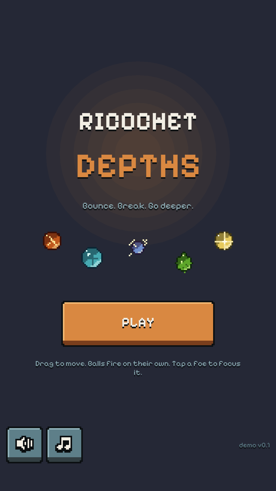

# Ricochet Depths

**Bounce. Break. Go deeper.**

A portrait ball-bouncing roguelite for TikTok mini games, built in Unity.


-ff0050)


</div>

---

Under the hill town of Peal, an old bell foundry slid into a sinkhole. A crew of misfits goes down the shaft with launchers that throw enchanted shot. Every bounce breaks the slag creatures climbing up from below.

Drag to move. Your balls fire on their own. Tap a foe to focus it. Pick upgrades, fuse balls into stronger ones, and survive long enough to face the Bellwarden.

<div align="center">
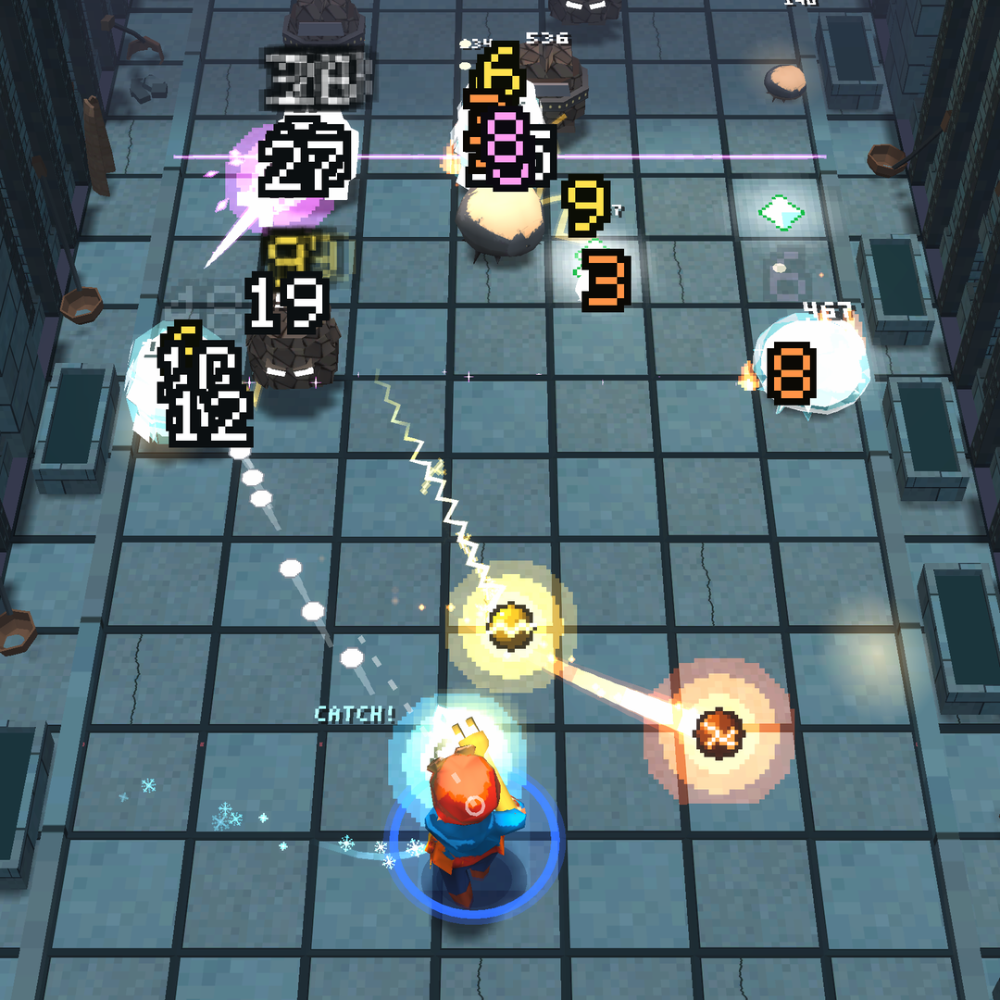
<br><br>
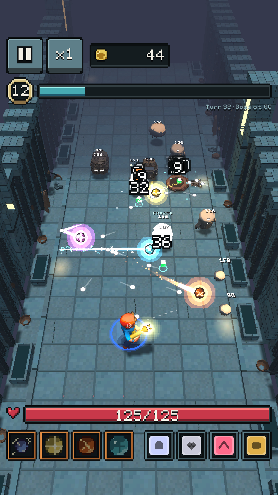
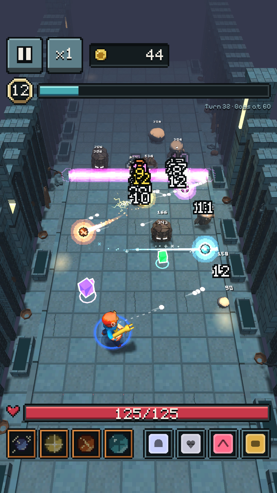
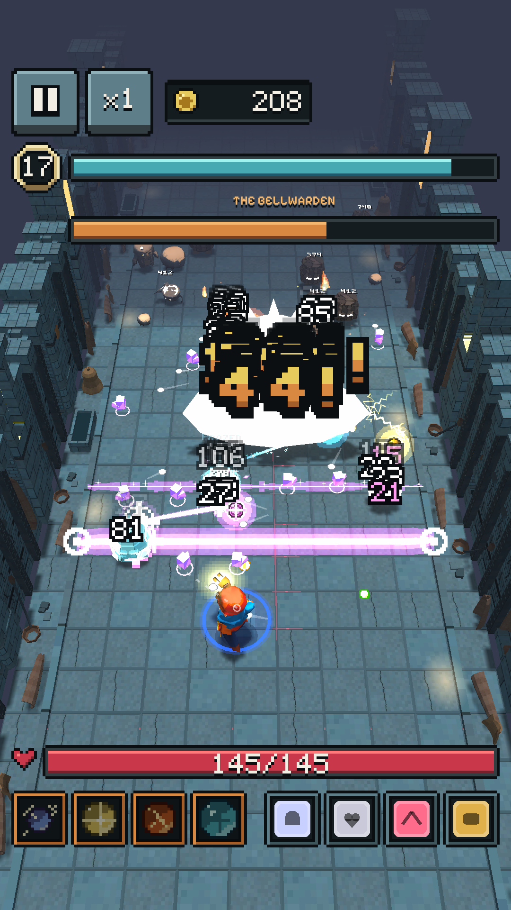
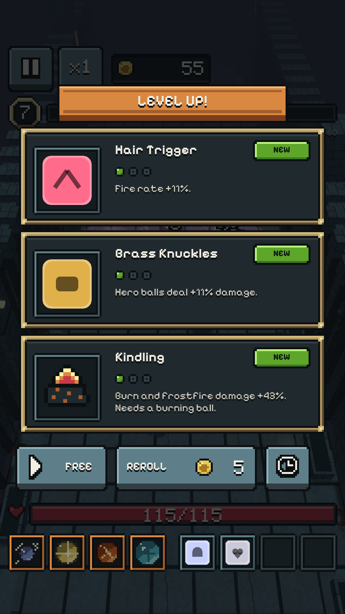
<br>
<sub>Fight · Ray beams · Boss · Level up</sub>
</div>

## Highlights

- **Bounce combat on a scrolling corridor.** The board slides toward you one row per turn. Balls ricochet off walls and foes, then come back to the launcher.
- **14 balls and 12 evolutions.** Burn, freeze, poison, bleed, chain lightning, row and column beams, bombs, splitting shot and more. Max two balls and fuse them in **the Crucible**.
- **22 foe types and 3 bosses.** Shooters, mortars, healers, hatchers, burrowers, shields and elites, with telegraphed attacks you can read and dodge.
- **6 heroes.** Each has their own stat spread, starting ball and rule twist (ricochet, scatter, pierce-to-wall, paddle swat, fan volley).
- **Layered hero animation.** The upper body aims left, forward or right and kicks on every shot. The legs walk, strafe and back-pedal on their own layer.
- **Built for TikTok.** Portrait, English UI, a WebGL build of about 7.5 MiB, and rewarded-ad hooks (revive, free reroll, +1 upgrade) behind a placeholder ad service.

## Balls

<div align="center">
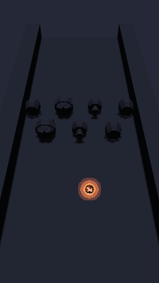
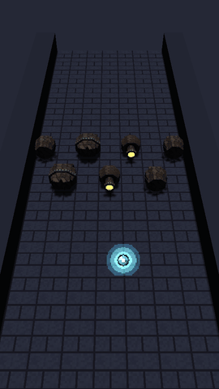
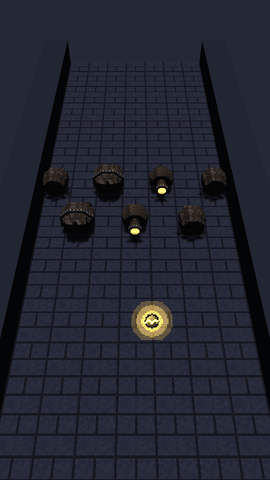
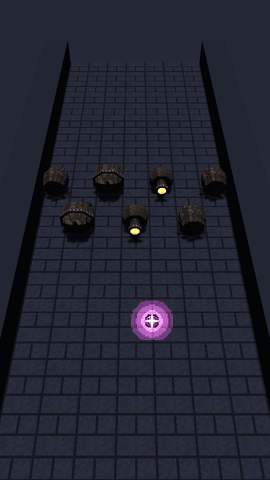
<br>
<sub><b>Ember</b> burns · <b>Rime</b> freezes · <b>Spark</b> chains · <b>Ray</b> beams the whole row</sub>
</div>

## Cast

<div align="center">
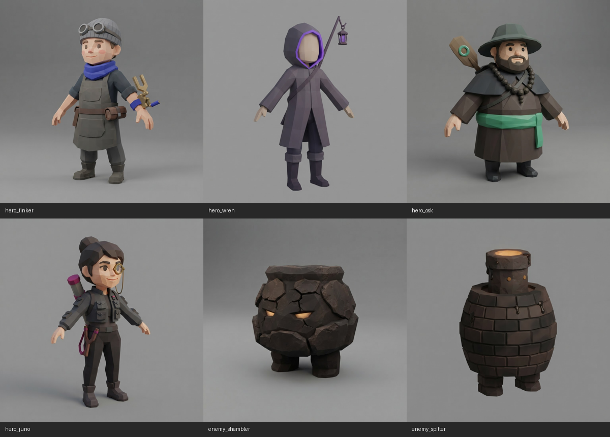
<br>
<sub>Concept renders: Tinker, Wren, Osk, Juno, and two of the slag foes</sub>
<br><br>
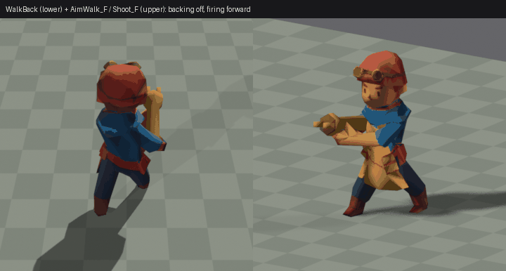
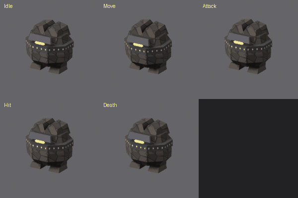
<br>
<sub>In-engine low-poly rigs: Tinker back-pedalling and firing, the Brute's full motion set</sub>
</div>

## Repository layout

| Folder | Owner | Contents |
|---|---|---|
| [`ballpit-spec/`](ballpit-spec) | design | Rules and numbers (`spec.md`), visual parameters (`style.md`), ad placements (`ads.md`) |
| [`pit-unity/`](pit-unity) | engineering | The Unity project: pure C# simulation, 3D view layer, WebGL build and TikTok packaging |
| [`pit-art/`](pit-art) | art | Art bible, concept images, low-poly heroes and foes, Blender rigging and animation tools |
| [`pit-scene/`](pit-scene) | scene | Level 1 modular corridor kit, lighting and assembly notes |
| [`pit-vfx/`](pit-vfx) | VFX | Ball effects lab, `RicochetVfx.unitypackage`, previews |
| [`pit-ui/`](pit-ui) | UI | Pixel UI atlas, sliced assets, screen mockups, `UI-SPEC.md` |
| [`pit-audio/`](pit-audio) | audio | Synthesised SFX and battle loop, made from scratch with `tools/gen.py` |

## Building

1. Open `pit-unity/` in **Unity 6000.6.6f1**. The game builds itself at runtime, so the scene can be empty.
2. Run **Pit/Setup URP**, then **Pit/Apply WebGL Size Settings**.
3. Build WebGL from the **Pit** menu. `pit-unity/TikTok/README.md` covers packaging it as a TikTok mini game.

Headless checks without the Editor (needs the .NET SDK):

```bash
cd pit-unity/Tools/SimHarness && dotnet run -c Release -- 10 all 25
```

```bash
cd pit-unity/Tools/StubCheck && dotnet run -c Release -- 2
```

The first plays full bot runs through the simulation. The second drives every screen through the real draw code against a stubbed UnityEngine.

## Status

This is a **demo**: level 1 only, without meta progression. The ads are a 2-second placeholder until real TikTok ad units are set up. Bosses still use placeholder models.

## Clean room

Ricochet Depths is an original game. Its design was written down as an abstract spec in `ballpit-spec/`, and all code, art, audio, names and story were made only from that spec. No code, art or audio from any other game is in this repository, and `.gitignore` uses a whitelist to keep it that way.

## Credits

- Font: [Pixelify Sans](https://fonts.google.com/specimen/Pixelify+Sans) by Stefie Justprince, SIL Open Font License 1.1
- Audio: original, synthesised for this project (see [`pit-audio/LICENSES.md`](pit-audio/LICENSES.md))
- Everything else: original work for this project. All rights reserved.
